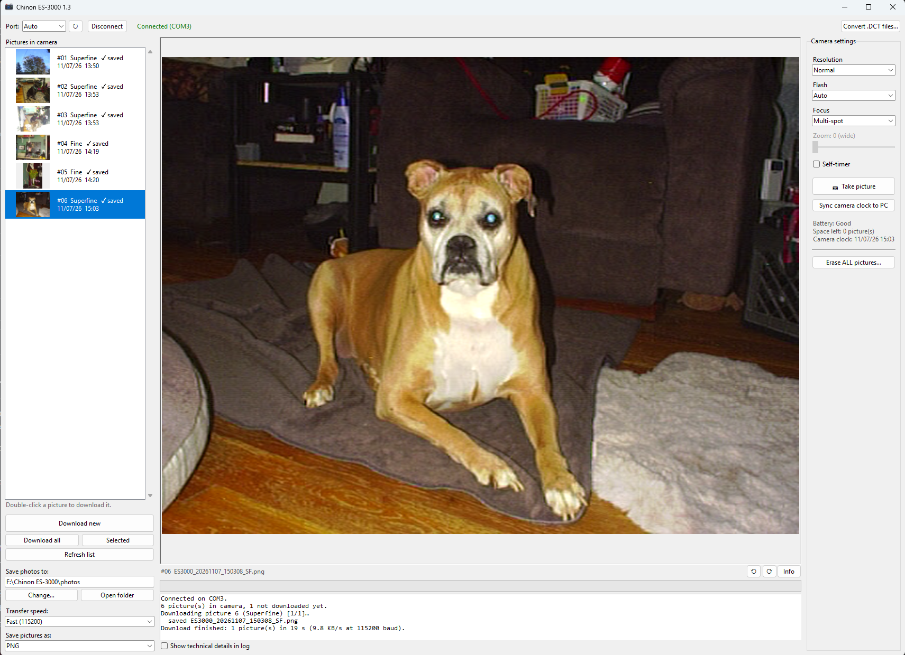
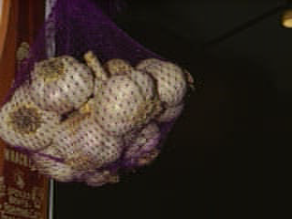
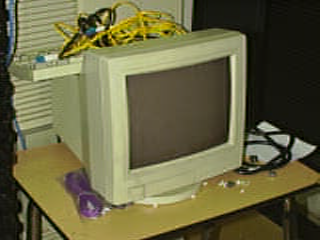

# Chinon ES-3000 for modern Windows

Download, convert, and control a **Chinon ES-3000** (1995) digital camera from Windows 10/11.
No Windows 3.1, no virtual machine, and no original software needed.

The camera's serial protocol and its `.DCT` image format were reverse-engineered from the
original 1995 driver and serial captures.

I have not tested this with the other OEM models: Dakota DCC 9500, Dycam 10-C, Kodak DC50 zoom, and Promaster Digital One



## What it does

* Finds the camera on any COM port automatically
* Lists the pictures in the camera with their dates and a small preview (decoded from the
  camera's thumbnails)
* Downloads them as `.DCT` (original data) + `.png`; **Download new** skips pictures
  already in your folder
* Optional fast transfers at 115200 baud, with automatic fallback to 57600
* Converts old `.DCT` files saved by the original software
* Remote control: resolution, flash, focus, zoom, self-timer, take a picture, set the clock,
  erase all
* Saves as PNG, JPG, TIFF or BMP; lossless rotate; picture info; battery indicator
* Remembers your port, save folder and speed between runs
* Reads the camera's current settings, pictures left, and the date each photo was taken
  (downloaded files are named and time-stamped with it)

## You need

* The camera's PC serial cable (8-pin mini-DIN to DB9)
* A USB-to-RS232 (DB9) adapter. FTDI-based adapters work well.
* The camera switched on: slide the **lens cover** open and keep it open while connected.

## Quick start

**Easiest:** download `Chinon ES-3000.exe` from the
[Releases](../../releases) page and run it. No Python needed.

**From source:**

1. Install Python 3 (`winget install -e --id Python.Python.3.13`)
2. Double-click `src/Run Chinon App.bat`
3. Click **Connect**, then **Download new**

To get a standalone `Chinon ES-3000.exe`, run `src/Build EXE.bat`.

Command line (no window):

```
pip install -r requirements.txt
python src/chinon_decode.py picture.DCT        # -> picture.png
```

## Sample photos

Taken with an ES-3000 and downloaded/decoded with this app (unedited apart from rotation).

| Superfine (640×480) | Fine (640×480, rotated) |
|---|---|
|  |  |

| Normal (320×240) | Normal (320×240) |
|---|---|
|  |  |

## Docs

* [PROTOCOL.md](PROTOCOL.md): serial link, commands, packets, status bytes
* [DCT_FORMAT.md](DCT_FORMAT.md): the image file format and how the decoder works

## Files

| | |
|---|---|
| `src/chinon_app.py` | Windows app (Tkinter) |
| `src/chinon_camera.py` | protocol library |
| `src/chinon_decode.py` + `chinon_params.json` | `.DCT` → image decoder, thumbnail decoder |
| `src/chinon.ico` | app icon |
| `tools/chinon_sniffer.py` | serial man-in-the-middle logger used for the reverse engineering (VirtualBox TCP serial ↔ real COM port) |

## Status

Verified on a real camera: connect, status, picture list, download (byte-identical to the
original software), decode of all three resolutions, resolution, flash, focus, zoom,
self-timer, take picture, set clock, photo timestamps, and erase all. Thumbnails are decoded
from recorded camera data. 115200 baud works (Superfine in ~18 s instead of ~38 s). Not yet verified: the low-battery code, PC-card
commands, and anything on the rebadged models.

## Notes

This project contains no code or files from the original Chinon/Monsoon software. You
need your own camera and cable.
